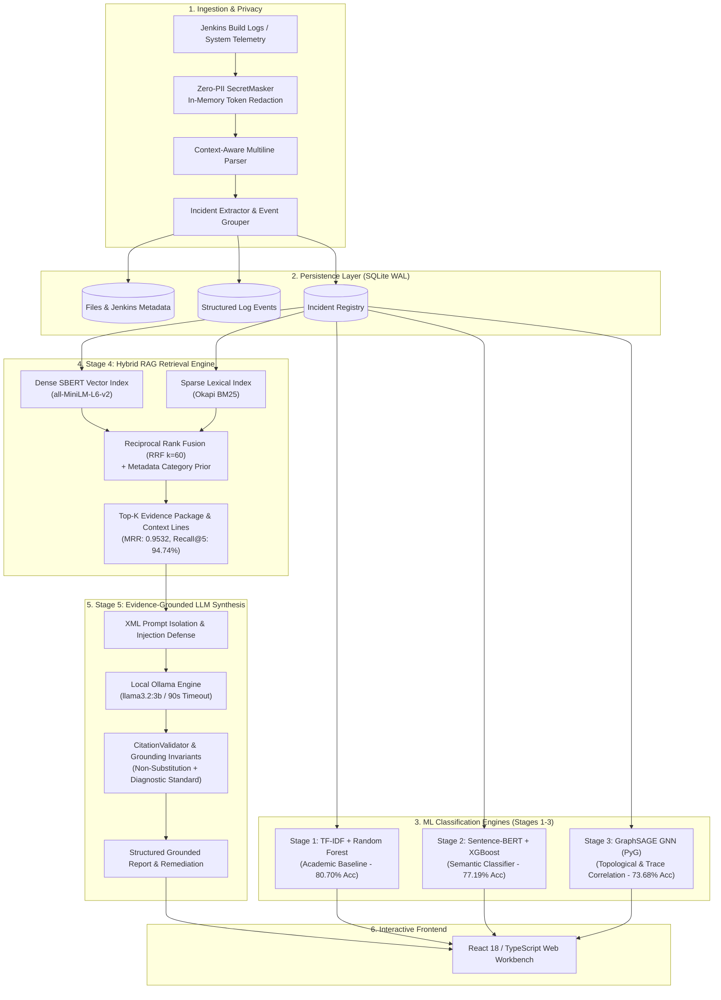

# TRACE — Automated Log Analysis and Root Cause Detection System using Machine Learning

[](https://www.python.org/downloads/release/python-3110/)
[](https://fastapi.tiangolo.com)
[](https://pytorch.org/)
[](https://pyg.org/)
[](https://react.dev/)
[](https://www.typescriptlang.org/)
[](https://vitejs.dev/)
[](https://www.sqlite.org/wal.html)
[](https://ollama.com/)
[](#14-automated-testing--verification-suite)

> **TRACE** is an enterprise-grade, privacy-preserving log analytics and root-cause intelligence platform. It ingests heterogeneous CI/CD console logs and microservice telemetry, strips sensitive credentials in-memory, parses complex multiline runtime events, classifies failure incidents across three distinct machine learning paradigms, retrieves historical diagnostic evidence using hybrid RAG, and synthesizes evidence-grounded root-cause reports with verified remediation guidance using a local on-premises LLM.

---

## Table of Contents
1. [Executive Summary](#1-executive-summary)
2. [End-to-End System Architecture](#2-end-to-end-system-architecture)
3. [The Five ML & AI Stages](#3-the-five-ml--ai-stages)
4. [Key Engineering Capabilities](#4-key-engineering-capabilities)
5. [Technology Stack](#5-technology-stack)
6. [Repository Structure](#6-repository-structure)
7. [Empirical Evaluation & Benchmarks](#7-empirical-evaluation--benchmarks)
8. [Data Leakage Audit & Academic Transparency](#8-data-leakage-audit--academic-transparency)
9. [Installation & Setup](#9-installation--setup)
10. [Running the Application](#10-running-the-application)
11. [Jenkins CI/CD Integration](#11-jenkins-cicd-integration)
12. [REST API Reference Summary](#12-rest-api-reference-summary)
13. [Security, Privacy & Responsible AI](#13-security-privacy--responsible-ai)
14. [Automated Testing & Verification Suite](#14-automated-testing--verification-suite)
15. [Live Demonstration Script Summary](#15-live-demonstration-script-summary)
16. [Troubleshooting & FAQ](#16-troubleshooting--faq)
17. [Documentation Sitemap](#17-documentation-sitemap)
18. [Authors & Attribution](#18-authors--attribution)

---

## 1. Executive Summary

Modern enterprise software systems and automated CI/CD pipelines generate massive volumes of unstructured, noisy log data. When builds break or microservices crash, Site Reliability Engineers (SREs) face three critical bottlenecks:
1. **Diagnostic Latency:** Engineers spend hours manually sifting through thousands of log lines to extract stack traces and pinpoint root causes.
2. **Credential Leakage:** Raw console output frequently exposes sensitive credentials (bearer tokens, AWS keys, GitHub personal access tokens, private IPs), making logs unsafe to share or process via cloud APIs.
3. **Hallucinated Remediation:** Generic AI assistants frequently hallucinate non-existent error causes, substitute missing citations, or recommend superficial defensive fixes (e.g. wrapping failing code in empty `try...catch` blocks) that mask rather than solve underlying faults.

**TRACE solves these challenges** through an integrated, 5-stage ML/AI architecture running entirely on-premises, guaranteeing that zero confidential telemetry leaves the local infrastructure.

---

## 2. End-to-End System Architecture

TRACE processes logs through a strictly ordered, deterministic pipeline:



---

## 3. The Five ML & AI Stages

| Stage | Model / Component | Representation | Primary Role | Canonical Performance |
|:---:|:---|:---|:---|:---:|
| **Stage 1** | **TF-IDF + Random Forest** | 1500-D Lexical (Unigram + Bigram) | Fast, transparent, interpretable academic baseline | **80.70% Accuracy**<br>72.81% Macro-F1 |
| **Stage 2** | **Sentence-BERT + XGBoost** | 384-D Dense Semantic (`all-MiniLM-L6-v2`) | Bridges lexical vocabulary gaps across distributed microservice dialects | **77.19% Accuracy**<br>65.31% Macro-F1 |
| **Stage 3** | **GraphSAGE GNN (PyG)** | 412-D Multimodal Node Features (SBERT + OneHot + Numerical) | Models topological relationships, trace correlations, and temporal incident co-occurrence | **73.68% Inductive Acc**<br>64.90% Macro-F1 |
| **Stage 4** | **Hybrid RAG Retrieval Engine** | Dual Dense Cosine + Sparse Okapi BM25 + RRF ($k=60$) | Retrieves top-$K$ historical incidents and surrounding chronological execution lines | **0.9532 MRR**<br>94.74% Recall@5 |
| **Stage 5** | **Evidence-Grounded LLM Synthesis** | Local Ollama (`llama3.2:3b`) with `CitationValidator` | Synthesizes grounded root-cause reports, validates citations, and enforces diagnostic remediation | **100% Audit Pass**<br>(7/7 Safety Scenarios) |

For in-depth mathematical formulations and architecture specifications, see [docs/ARCHITECTURE.md](docs/ARCHITECTURE.md).

---

## 4. Key Engineering Capabilities

- **Zero-PII Secret Sanitization:** Deterministic in-memory redaction of AWS access keys, GitHub PATs, JWT tokens, Bearer authorization headers, passwords, and private RFC 1918 IPv4 addresses before storage.
- **Context-Aware Multiline Parsing:** Automatically aggregates multiline Java/Python exceptions and stack traces under their respective parent log event.
- **Jenkins CI/CD Provenance Tracking:** Captures build numbers, job names, Git commit SHAs, and branch metadata directly alongside log telemetry.
- **Unified Model Registry:** Clean decoupled architecture allowing instant switching between Stage 1, Stage 2, and Stage 3 classifiers with explicit backend result verification.
- **Reciprocal Rank Fusion (RRF):** Robust rank aggregation overcoming individual weaknesses in lexical and semantic retrieval.
- **The Non-Substitution Invariant:** Hallucinated citations (e.g. `[E99]`) are never silently replaced with valid ones; ungrounded statements are flagged for human review.
- **The Diagnostic Remediation Principle:** The system prioritizes diagnosing the root cause (e.g. identifying the null variable and upstream producer) over proposing blind try-catch blocks.
- **Independent Status Decoupling:** The UI cleanly separates Provider Connectivity, Synthesis Status, Privacy Sanitization, and Grounding Validation.

---

## 5. Technology Stack

- **Backend Framework:** FastAPI 0.109+, Uvicorn (ASGI), Pydantic v2
- **Machine Learning & Graph Neural Networks:**
  - PyTorch 2.2+ (CPU-optimized)
  - PyTorch Geometric 2.5+ (`SAGEConv`)
  - Sentence-Transformers 2.5+ (`all-MiniLM-L6-v2`)
  - XGBoost 2.0+ (`multi:softprob`)
  - Scikit-Learn 1.4+ (`RandomForestClassifier`, `TfidfVectorizer`)
  - Rank-BM25 (Okapi BM25 sparse scoring)
- **Local LLM Engine:** Ollama for Windows running `llama3.2:3b`
- **Database:** SQLite 3 configured in WAL (Write-Ahead Logging) mode
- **Frontend Workbench:** React 18.3, TypeScript 5.5, Vite 6.4, Tailwind CSS, Lucide React icons
- **Automated Testing:** Pytest 8.0+, HTTPX, Scikit-Learn evaluation suites

---

## 6. Repository Structure

```
automated-log-analysis-root-cause-detection/
├── .env.example                               # Sample environment variables
├── .gitignore                                 # Git ignore (protects models cache & DB)
├── README.md                                  # Root documentation (this document)
├── backend/
│   ├── requirements.txt                       # Python dependencies (PyTorch, PyG, FastAPI)
│   ├── app/
│   │   ├── main.py                            # FastAPI application entrypoint & lifespan
│   │   ├── api/v1/                            # REST API route endpoints
│   │   │   ├── api.py                         # Unified API router
│   │   │   ├── endpoints/                     # Ingestion, incidents, RCA, RAG, metrics
│   │   ├── core/                              # Security (SecretMasker), database (WAL), config
│   │   ├── ml/                                # Machine learning stage implementations
│   │   │   ├── baseline/                      # Stage 1: TF-IDF + Random Forest
│   │   │   ├── stage1_embedder/               # Sentence-BERT dense vectorizer
│   │   │   ├── stage2_classifier/             # Stage 2: XGBoost classifier
│   │   │   ├── stage3_gnn/                    # Stage 3: GraphSAGE GNN (PyG)
│   │   │   ├── stage4_rag/                    # Stage 4: Hybrid RAG (BM25 + SBERT + RRF)
│   │   │   ├── stage5_llm/                    # Stage 5: Ollama provider & CitationValidator
│   │   │   └── model_registry.py              # Central ML runtime model dispatcher
│   │   ├── parsers/                           # Context-aware multiline log parser
│   │   └── schemas/                           # Pydantic data schemas
│   ├── data/
│   │   ├── raw/                               # Authentic Jenkins & system log files
│   │   ├── processed/                         # Canonical group-aware dataset splits
│   │   ├── models_cache/                      # Trained model joblib & manifest files
│   │   └── *.json                             # Evaluation and audit manifests
│   └── tests/                                 # 91 unit, integration, and regression tests
├── docs/                                      # Topic documentation guides
│   ├── INSTALLATION.md                        # Windows fresh-clone setup instructions
│   ├── ARCHITECTURE.md                        # Detailed architecture & pipeline design
│   ├── API_GUIDE.md                           # REST API reference with curl & JSON schemas
│   ├── USER_GUIDE.md                          # Interactive web dashboard operator manual
│   ├── DEMO_GUIDE.md                          # 10-12 minute academic evaluation script
│   ├── MODEL_EVALUATION.md                    # Empirical benchmarks & leakage audit report
│   └── SECURITY_AND_PRIVACY.md                # Security, SecretMasker & responsible AI guide
├── frontend/                                  # React 18 + TypeScript + Vite dashboard
│   ├── src/                                   # Application source (App.tsx, components)
│   ├── package.json                           # Node dependencies
│   └── vite.config.ts                         # Vite configuration
└── scripts/                                   # Benchmarks, training & evaluation scripts
    ├── evaluate_rag_retrieval.py              # Evaluates Stage 4 RAG metrics
    ├── evaluate_stage5_synthesis.py           # Audits Stage 5 grounding & safety invariants
    ├── run_leakage_audit_and_group_evaluation.py # Audits leakage & runs group-aware eval
    ├── start_servers.bat                      # Automated Windows startup batch script
    └── train_and_evaluate_graphsage.py        # Trains and evaluates Stage 3 GraphSAGE
```

---

## 7. Empirical Evaluation & Benchmarks

All models were evaluated on the **Canonical Group-Aware Stratified Test Set** of 57 held-out incidents (partitioned strictly by source log file and Jenkins build, eliminating cross-set template leakage):

### 7.1 Classifier Comparison (Stages 1–3)

| Model | Representation | Accuracy | Macro-F1 | Precision (Macro) | Recall (Macro) | CPU Latency |
|:---|:---|:---:|:---:|:---:|:---:|:---:|
| **Stage 1: TF-IDF + Random Forest** | 1500-D Bag-of-Words | **80.70%** | **72.81%** | **72.35%** | **75.89%** | 32.65 ms |
| **Stage 2: Sentence-BERT + XGBoost** | 384-D Dense Semantic | **77.19%** | 65.31% | 64.17% | 71.58% | 34.98 ms |
| **Stage 3: GraphSAGE GNN (Inductive)**| 412-D Multimodal Graph | **73.68%** | 64.90% | 61.79% | 74.29% | **30.52 ms** |

*(Stage 3 GraphSAGE achieves 70.04% weighted F1 due to class imbalance).*

### 7.2 Stage 4 Hybrid RAG Retrieval Performance

Evaluated across **57 held-out query incidents** against a historical corpus of **268 incidents**:

| Modality | HitRate@1 (Recall@1) | HitRate@3 | HitRate@5 | HitRate@10 | True Recall@5 | Precision@1 | MRR | Latency |
|:---|:---:|:---:|:---:|:---:|:---:|:---:|:---:|:---:|
| **Hybrid (BM25 + SBERT + Prior)** | **94.74%** | **94.74%** | **94.74%** | **100.0%** | **15.64%** | **94.74%** | **0.9532** | 17.98 ms |
| **Sparse Lexical (Okapi BM25)** | 73.68% | 89.47% | 89.47% | 94.74% | 12.47% | 73.68% | 0.8082 | **1.16 ms** |
| **Dense Semantic (Sentence-BERT)** | 71.93% | 87.72% | 89.47% | 94.74% | 10.65% | 71.93% | 0.7946 | 16.15 ms |

*Note on Retrieval Metrics:* `Recall@k` represents **HitRate@k (Success@k)**: the proportion of queries with at least one matching category incident retrieved in the top-$k$. **True Recall@k** evaluates the fraction of all matching incidents in the 268-incident training corpus retrieved in the top-$k$ (mean ~27 per class in train split).

### 7.3 Stage 5 Grounding & Safety Audit
- **Total Evaluated Scenarios:** 7
- **Passed Scenarios:** 7 (100% pass rate)
- Verified: Non-substitution of `[E99]`, remediation grounding invariant enforcement, diagnostic remediation, prompt injection neutralization, and 90s timeout handling.
- **Provider Resilience:** If Ollama is offline, the API honestly returns `status="provider_unavailable"` without fabricating hallucinated reports, while Stage 1-3 ML classifiers and Stage 4 RAG retrieval continue operating uninterrupted.

Full metrics manifests are available in `backend/data/*.json` and analyzed in [docs/MODEL_EVALUATION.md](docs/MODEL_EVALUATION.md).

---

## 8. Data Leakage Audit & Academic Transparency

To uphold scientific honesty, TRACE discloses the resolution of two data leakage vulnerabilities present in early exploratory builds:

1. **The Template Leakage Flaw:** A naive record-level split allowed identical recurring Jenkins log lines to appear in both train and test sets, artificially inflating accuracy to 92.98% (RF) and 96.49% (XGBoost). Creating our **Group-Aware Split** eliminated this overlap, establishing genuine accuracies of **80.70%** and **77.19%**.
2. **Transductive vs. Inductive Graph Evaluation:** When GraphSAGE is evaluated transductively (allowing message passing across test-node edges), it reaches 96.49%. When evaluated strictly **inductively** (where test incidents are completely unseen nodes), it achieves a genuine **73.68%**.
3. **Weak Supervision Ground Truth:** Target labels were generated using rule-based heuristics (`RootCauseCandidateAnalyzer`) rather than manual human SRE labels. This explains why Stage 1 (TF-IDF) slightly outperforms dense models: it matches the exact keyword rules used to generate the labels.

---

## 9. Installation & Setup

For detailed instructions, see [docs/INSTALLATION.md](docs/INSTALLATION.md).

### Quickstart (Windows PowerShell)

#### Automated Setup (Recommended)
Clone the repository and run the automated setup script, which creates the Python virtual environment, installs backend and frontend dependencies, configures `.env`, and initializes the database and ML model artifacts:
```powershell
git clone https://github.com/ManikSalaria/automated-log-analysis-root-cause-detection.git
cd automated-log-analysis-root-cause-detection
powershell -ExecutionPolicy Bypass -File .\scripts\setup_windows.ps1
```

#### Manual Setup
```powershell
# 1. Set up Python virtual environment (Python 3.11 required)
python -m venv .venv
.\.venv\Scripts\Activate.ps1

# 2. Install backend dependencies
python -m pip install --upgrade pip setuptools wheel
pip install -r backend/requirements.txt

# 3. Configure environment
Copy-Item .env.example .env

# 4. Install frontend dependencies
cd frontend
npm install
npm run build
cd ..

# 5. Bootstrap database and ML models (TF-IDF, XGBoost, GraphSAGE, BM25 Index)
python scripts/bootstrap_models.py

# 6. Optional: Pull Ollama model for Stage 5 LLM synthesis (if Ollama is installed)
ollama pull llama3.2:3b
```

---

## 10. Running the Application

### Option A: Automated Launch Script (Recommended)
Run the PowerShell launcher (or batch script) from the root directory:
```powershell
.\scripts\start_trace.ps1
# OR
.\scripts\start_servers.bat
```

### Option B: Manual Launch

**Terminal 1 — FastAPI Backend:**
```powershell
.\.venv\Scripts\Activate.ps1
uvicorn backend.main:app --host 0.0.0.0 --port 8000 --reload
```
- API Base URL: `http://localhost:8000`
- Interactive Swagger UI: `http://localhost:8000/docs`
- Health Endpoint: `http://localhost:8000/api/v1/health`

**Terminal 2 — React Dashboard Frontend:**
```powershell
cd frontend
npm run dev
```
- Web Dashboard: `http://localhost:3000` (proxies `/api` calls to `http://localhost:8000`)

---

## 11. Jenkins CI/CD Integration

TRACE integrates with Jenkins pipelines via HTTP REST or raw console log ingestion:
- **Pipeline setup:** Configure a Jenkins Pipeline job to use this repository, select the branch to build, and set the script path to `Jenkinsfile`. The pipeline builds the React dashboard and posts its complete Jenkins `consoleText` with build status and provenance to TRACE after each run. Empty logs are rejected instead of being replaced with status-only text; logs over 20 MB are rejected rather than truncated.
- **JSON Endpoint:** `POST /api/v1/ingest/jenkins` accepts `job_name`, `build_number`, `build_status`, `console_log`, and optional `build_url`, `repo_url`, `git_commit`, and `git_branch` values.
- **Direct Upload:** Upload raw console logs (`consoleText`) through `POST /api/v1/ingest/upload` with optional Jenkins metadata fields.
- **Automatic analysis:** Both ingestion routes sanitize and parse every log line, run the full log through baseline, XGBoost, and GraphSAGE classifiers, calculate root-cause candidates, retrieve related historical incidents, and generate a cited Stage 5 report when the configured LLM is available. Results are stored against that exact ingestion and shown in the dashboard's **Latest Ingestion Analysis** card; citation validation warnings are surfaced for human review.
- **Per-ingestion results:** `GET /api/v1/ingest/latest/analysis` returns the latest ingestion's processing stages and report; `GET /api/v1/ingest/{file_id}/analysis` returns results for a specific upload/build.
- **Pipeline smoke test:** Run the Jenkins job with `TRACE_INGESTION_SMOKE_TEST=true` to emit a controlled payment-dependency failure signature and verify the complete ingestion path. It is disabled by default.
- **Run locally:** Keep TRACE running at `http://127.0.0.1:8000`; the repository's `scripts/jenkins_post_build.ps1` posts the build log to this local endpoint and reports a warning if TRACE is unavailable.

---

## 12. REST API Reference Summary

| Endpoint | Method | Description |
|:---|:---:|:---|
| `/api/v1/health` | `GET` | Health check, DB state, and live Ollama provider connectivity |
| `/api/v1/ingest/upload` | `POST` | Upload and sanitize raw log file (`multipart/form-data`) |
| `/api/v1/ingest/jenkins` | `POST` | Ingest raw Jenkins build console text with build metadata |
| `/api/v1/ingest/latest/analysis` | `GET` | Latest ingestion's model, RAG, and LLM processing results |
| `/api/v1/ingest/{file_id}/analysis` | `GET` | Processing results tied to one exact ingestion |
| `/api/v1/incidents` | `GET` | Paginated incident list with severity/component filters |
| `/api/v1/incidents/{incident_id}` | `GET` | Incident detail view with chronological context lines |
| `/api/v1/analysis/analyze` | `POST` | Full analysis with secret sanitization, parsing, and ML classification |
| `/api/v1/classify` (or `/api/v1/classification/classify`) | `POST` | Direct ML inference using Stage 1, Stage 2, or Stage 3 |
| `/api/v1/rag/retrieve` | `POST` | Hybrid RAG retrieval (BM25 + SBERT + RRF $k=60$) |
| `/api/v1/analysis/synthesize` (or `/api/v1/rag/synthesize`) | `POST` | Stage 5 LLM root-cause synthesis with `CitationValidator` |
| `/api/v1/analysis/llm-provider-status` | `GET` | Diagnostic check of active LLM provider (Ollama / offline) |
| `/api/v1/rag/corpus-stats` | `GET` | RAG indexed corpus diagnostic statistics |
| `/api/v1/rag/evaluation-metrics` | `GET` | Canonical RAG retrieval benchmark manifest |
| `/api/v1/metrics/comparison` | `GET` | Canonical evaluation metrics across all 5 stages |
| `/api/v1/metrics/audit` | `GET` | Leakage audit manifest and empirical baseline metrics |

For complete request schemas, curl examples, and response JSON payloads, see [docs/API_GUIDE.md](docs/API_GUIDE.md).

---

## 13. Security, Privacy & Responsible AI

1. **Air-Gapped & Local Guarantee:** All models and the Ollama LLM sidecar run strictly on local infrastructure. No incident data or telemetry is sent to public cloud endpoints.
2. **Zero-PII SecretMasker:** AWS credentials, GitHub PATs, JWT tokens, Bearer headers, and private IPs are redacted in-memory prior to persistence or model ingestion. Raw logs are not retained in SQLite unless `ALLOW_RAW_LOG_RETENTION=True` is explicitly configured.
3. **Prompt Injection Delimiters:** Log text is isolated in non-executable `<log_evidence>` XML tags with explicit instructions to ignore instructions contained within logs.
4. **Non-Substitution Citation Rule:** Hallucinated evidence citations (`[E99]`) are rejected, never silently replaced with unrelated citations.
5. **Diagnostic First:** Prioritizes identifying root-cause sources over blanket try-catch suppression.

For detailed security regexes and governance principles, see [docs/SECURITY_AND_PRIVACY.md](docs/SECURITY_AND_PRIVACY.md).

---

## 14. Automated Testing & Verification Suite

TRACE maintains comprehensive test coverage across all components:

```powershell
# 1. Run full backend pytest test suite (94 passing tests)
.\.venv\Scripts\python.exe -m pytest backend/tests -v

# 2. Run Stage 4 Hybrid RAG evaluation benchmark
.\.venv\Scripts\python.exe scripts/evaluate_rag_retrieval.py

# 3. Run Stage 5 LLM grounding & safety audit suite
.\.venv\Scripts\python.exe scripts/evaluate_stage5_synthesis.py

# 4. Verify frontend production build (TypeScript & Vite)
cd frontend; npm run build; cd ..
```

**Verification Results:**
- `pytest`: **94 passed** in ~66 seconds (including privacy persistence regression suite).
- `evaluate_rag_retrieval.py`: **MRR: 0.9532, HitRate@5: 94.74%, True Recall@5: 15.64%**.
- `evaluate_stage5_synthesis.py`: **7/7 scenarios passed** (100% pass rate).
- `frontend build`: **0 errors**, production bundle compiled in ~2.3 seconds.

---

## 15. Live Demonstration Script Summary

Planning an evaluation presentation? Consult [docs/DEMO_GUIDE.md](docs/DEMO_GUIDE.md) for a complete 10-to-12-minute script:
- **00:00 - 02:00:** Problem Statement & CI/CD Pain Points
- **02:00 - 04:00:** Ingestion & Live Zero-PII Secret Masking
- **04:00 - 06:00:** Multi-Stage ML Classification (Stages 1–3)
- **06:00 - 08:00:** Stage 4 Hybrid RAG Historical Retrieval
- **08:00 - 10:00:** Stage 5 Evidence-Grounded LLM Synthesis & Diagnostic Remediation
- **10:00 - 12:00:** Data Leakage Audit, Scientific Transparency & Q&A

---

## 16. Troubleshooting & FAQ

### Q1: Ollama request times out or returns `TIMEOUT`
- **Solution:** Large logs or high CPU load can cause inference to take longer than standard HTTP timeouts. TRACE provides `TRACE_LLM_TIMEOUT_SEC=90.0` in `.env`. Ensure Ollama is running (`ollama serve`) and has loaded `llama3.2:3b`. If Ollama is unavailable, TRACE falls back to offline deterministic synthesis.

### Q2: PyTorch Geometric wheel installation errors on Windows
- **Solution:** PyG binaries depend on exact Python and PyTorch versions. Use the pre-built CPU wheels:
  ```powershell
  pip install torch --index-url https://download.pytorch.org/whl/cpu
  pip install torch-scatter torch-sparse torch-cluster torch-spline-conv -f https://data.pyg.org/whl/torch-2.2.0+cpu.html
  pip install torch-geometric
  ```

### Q3: Frontend shows model name different from selection
- **Solution:** TRACE explicitly displays the model name returned by the backend response, preventing UI selection desynchronization. If the server fell back to a default baseline, the UI accurately flags this rather than showing the unexecuted selection.

---

## 17. Documentation Sitemap

Detailed documentation guides are available in the [`docs/`](docs/) directory:

- [Installation & Setup Guide](docs/INSTALLATION.md) — Comprehensive Windows prerequisites, virtualenv, and build steps.
- [System Architecture & Pipeline Design](docs/ARCHITECTURE.md) — In-depth component interactions, ML formulations, and data flow.
- [REST API Reference Guide](docs/API_GUIDE.md) — Complete endpoint reference with curl examples and JSON payloads.
- [User & Operator Manual](docs/USER_GUIDE.md) — Interactive UI walkthrough for each dashboard tab.
- [Demonstration & Review Script](docs/DEMO_GUIDE.md) — 10-12 minute live presentation guide with anticipated Q&A.
- [Model Evaluation & Leakage Audit](docs/MODEL_EVALUATION.md) — Scientific benchmarks, group-aware split audit, and RAG metrics.
- [Security, Privacy & Responsible AI](docs/SECURITY_AND_PRIVACY.md) — SecretMasker regexes, prompt injection defense, and grounding invariants.

---

## 18. Authors & Attribution

- **Project:** TRACE — Automated Log Analysis and Root Cause Detection System using Machine Learning
- **Repository:** [https://github.com/ManikSalaria/automated-log-analysis-root-cause-detection](https://github.com/ManikSalaria/automated-log-analysis-root-cause-detection)
- **Primary Investigator:** Manik Salaria
