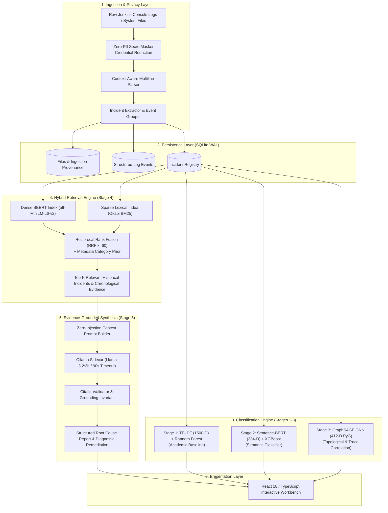

# TRACE System Architecture & Pipeline Design

This document details the architectural principles, data flow, component interactions, and machine learning models comprising **TRACE** (Automated Log Analysis and Root Cause Detection System).

---

## 1. High-Level Architecture Overview

TRACE is an end-to-end log intelligence and root-cause analysis platform that operates across five coordinated machine learning and artificial intelligence stages:

---

## 2. Ingestion, Privacy & Parsing Engine

### 2.1 Zero-PII SecretMasker
Enterprise logs frequently leak authentication tokens and internal infrastructure identifiers. TRACE sanitizes all incoming log text in-memory prior to persistence or model feature extraction using deterministic regex patterns:

- **AWS Credentials:** Detects `AKIA[0-9A-Z]{16}` and associated 40-character secret keys $\rightarrow$ `[REDACTED_AWS_KEY]`.
- **GitHub PATs:** Detects `ghp_[A-Za-z0-9]{36}` $\rightarrow$ `[REDACTED_GITHUB_PAT]`.
- **JSON Web Tokens (JWT):** Detects `ey[A-Za-z0-9_-]{10,}\.[A-Za-z0-9._-]{10,}\.[A-Za-z0-9._-]{10,}` $\rightarrow$ `[REDACTED_JWT]`.
- **HTTP Authorization Headers:** Detects `Bearer [A-Za-z0-9._-]{20,}` $\rightarrow$ `Bearer [REDACTED_BEARER]`.
- **Password Assignments:** Detects `(password|passwd|pwd|secret)\s*[:=]\s*["']?([^"' \r\n]+)` $\rightarrow `$1=[REDACTED_PASSWORD]`.
- **Private IP Addresses:** Detects IPv4 RFC 1918 blocks (`10.x.x.x`, `172.16-31.x.x`, `192.168.x.x`) $\rightarrow$ `[REDACTED_IP]`.

### 2.2 Context-Aware Multiline Log Parsing
Log lines are parsed into structured event dictionaries with timestamp, log level, component name, trace ID, span ID, and message body. The parser handles multiline Java and Python stack traces by accumulating subsequent indented or un-timestamped lines into the parent event's `stack_trace` and `message` fields.

### 2.3 Incident Extraction & Boundary Detection
An incident represents a coherent failure episode. TRACE groups consecutive warning, error, and critical events occurring within temporal and trace-correlation windows. Each incident is assigned:
- A unique incident ID (`INC-xxxx`).
- Primary failure message and stack trace snippet.
- Line number boundaries (`start_line`, `end_line`) in the raw log file.
- Contextual event IDs spanning the failure timeline.

---

## 3. Data Persistence (SQLite with Write-Ahead Logging)

Data is persisted in an embedded SQLite database configured in **WAL (Write-Ahead Logging)** mode for concurrent read/write stability:

- `files`: Stores ingested file records, original filenames, file hash, line count, and Jenkins build provenance (`job_name`, `build_number`, `git_commit`, `git_branch`).
- `log_events`: Stores parsed individual log records with foreign keys to `file_id`, indexed by `timestamp`, `log_level`, `component`, and `trace_id`.
- `incidents`: Stores incident clusters with failure category, severity, message, stack trace, and associated event IDs.
- `evaluation_records`: Stores model evaluation metrics, split assignments, and confusion matrices.

---

## 4. The Five Machine Learning & AI Stages

### Stage 1: TF-IDF + Random Forest (Academic Baseline)
- **Role:** Transparent, lightweight bag-of-words lexical baseline.
- **Feature Pipeline:**
  - Unigram and bigram TF-IDF vectorization.
  - Sublinear TF scaling, max features = 1500, min document frequency = 2.
- **Classifier:**
  - Scikit-learn `RandomForestClassifier` (100 estimators, random state 42).
- **Inference Latency:** $\sim 32\text{ ms}$ on CPU.

### Stage 2: Sentence-BERT + XGBoost (Dense Semantic Classifier)
- **Role:** Semantic log representation that bridges vocabulary mismatches across heterogeneous log dialects.
- **Embedding Backbone:**
  - `sentence-transformers/all-MiniLM-L6-v2` generating 384-dimensional dense vectors.
  - Normalized embeddings mean-pooled across log messages.
- **Classifier:**
  - `XGBClassifier` with `multi:softprob` objective, 100 trees, learning rate 0.1, max depth 4.
- **Inference Latency:** $\sim 35\text{ ms}$ on CPU (including dense embedding encoding).

### Stage 3: GraphSAGE GNN (Topological & Trace Correlation)
- **Role:** Graph neural network modeling relationships between concurrent failure events across services, traces, and execution timelines.
- **Graph Construction:**
  - **Nodes:** Detected incidents.
  - **Node Features (412 dimensions):**
    - 384-D dense Sentence-BERT incident message embedding.
    - 10-D one-hot encoded incident severity.
    - 10-D one-hot encoded component service category.
    - 8-D scaled numerical features (stack trace depth, line span, event count, error density).
  - **Edges:**
    - Trace ID correlation (events sharing distributed trace contexts).
    - Temporal proximity (failures occurring within 30-second windows).
    - Semantic similarity (cosine similarity $\ge 0.75$ between dense embeddings).
- **GNN Architecture:**
  - 2-layer `SAGEConv` (PyTorch Geometric) with `mean` aggregation.
  - Hidden dimension: 128, Dropout: 0.3, Output: 10 incident classes.
- **Inference Latency:** $\sim 30\text{ ms}$ on CPU.

### Stage 4: Hybrid RAG Retrieval Engine
- **Role:** Retrieves top-$K$ historical incidents and surrounding chronological log lines to build an evidence package for diagnosis.
- **Dual Retrieval Pipeline:**
  1. **Dense Semantic Retrieval:** Cosine similarity over normalized 384-D SBERT embeddings indexed with cosine distance.
  2. **Sparse Lexical Retrieval:** Okapi BM25 index over tokenized log messages with frequency saturation ($k_1=1.5$) and document length normalization ($b=0.75$).
- **Reciprocal Rank Fusion (RRF):**
  $$\text{RRF\_Score}(d) = \alpha \cdot \frac{1}{k + r_{\text{dense}}(d)} + \beta \cdot \frac{1}{k + r_{\text{bm25}}(d)} + \gamma \cdot \text{Score}_{\text{metadata}}(d)$$
  Where $k=60$, $\alpha=0.5$, $\beta=0.3$, and $\gamma=0.2$ (category prior matching).
- **Context Expansion:**
  - Fetches $\pm 5$ chronological log events surrounding each retrieved incident to provide full execution context.

### Stage 5: Evidence-Grounded LLM Root Cause Synthesis
- **Role:** Translates retrieved log evidence into clear, actionable, evidence-backed diagnostic reports without hallucinations.
- **LLM Backbone:**
  - Ollama on-premises runtime serving `llama3.2:3b`.
  - Configurable timeout via `TRACE_LLM_TIMEOUT_SEC` (default: 90 seconds).
- **Prompt Isolation & Schema Enforcement:**
  - Retrieved logs are passed within strict non-executable XML delimiters (`<log_evidence>...</log_evidence>`) to neutralize prompt injection attempts.
  - Model is instructed to output strictly valid JSON conforming to `SynthesisReport`.
- **Citation & Grounding Validator:**
  - Enforces the **Grounding Invariant**: every claim and remediation suggestion must cite valid evidence IDs (`[E1]`, `[E2]`).
  - **Non-Substitution Invariant**: hallucinated IDs (e.g. `[E99]`) are never silently replaced with valid ones; claims citing invalid IDs are flagged as ungrounded.
  - **Diagnostic Remediation Principle**: prioritizes root-cause discovery (identifying null sources, inspecting upstream data) over naive defensive try-catch suppression.

---

## 5. Model Registry & Runtime Dispatcher

The FastAPI backend implements a unified `ModelRegistry` pattern:
- Pre-loads model checkpoints and vectorizers during application startup.
- Exposes a consistent `predict(incident)` interface across Stages 1, 2, and 3.
- Tracks inference latencies, confidence distributions, and fallback activations.
- Guarantees thread-safe inference across concurrent REST requests.

---

## 6. Frontend Dashboard Architecture

The user interface is built with **React 18**, **TypeScript**, and **Vite**:
- **State Management:** Decoupled local and tabbed state ensuring switching views preserves analysis results.
- **Model Result Integrity:** Explicitly displays the backend-returned model name, preventing UI selection mismatches.
- **Independent Status Indicators:** Separately visualizes Provider Connectivity (`Connected`/`Disconnected`), Synthesis Status (`SUCCESS`/`TIMEOUT`), Privacy Sanitization (`Sanitized`), and Grounding Validation.
- **Evidence Cards:** Renders expandable log evidence items with direct line numbers and copyable remediation commands.
